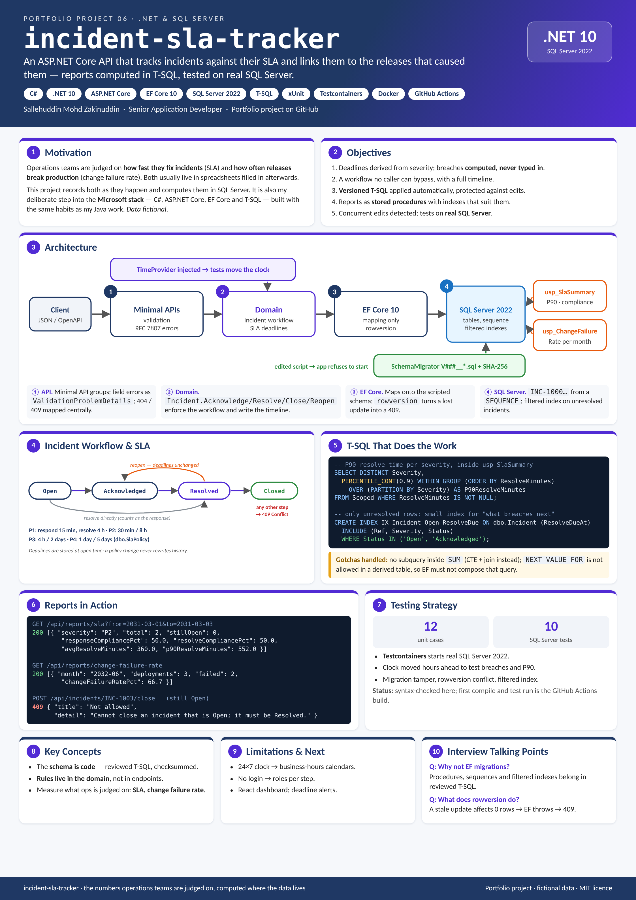

# incident-sla-tracker

| [How to use](docs/USAGE.md) | [Design document](docs/DESIGN.md) | [Poster (PDF, A3)](docs/poster.pdf) | [Changelog](CHANGELOG.md) |
|---|---|---|---|

<a href="docs/poster.png"></a>

An ASP.NET Core API that tracks production incidents against their SLA and links them to the releases that
caused them. Each incident gets response and resolution deadlines from its severity, and reports compute SLA
compliance and change failure rate in T-SQL stored procedures.

**Stack:** C# · .NET 10 · ASP.NET Core minimal APIs · EF Core 10 · SQL Server 2022 (T-SQL, stored procedures,
sequences, filtered indexes, rowversion) · xUnit · Testcontainers · Docker · GitHub Actions

## What it shows

| Area | How |
|---|---|
| Domain rules | `Incident` owns its workflow (Open → Acknowledged → Resolved → Closed, reopen) and SLA clock; invalid steps return 409 |
| Schema as code | Versioned T-SQL scripts run once each by a small migrator with SHA-256 checksums; editing an applied script stops start-up |
| T-SQL | `usp_SlaSummary` (compliance, average and P90 resolve time with `PERCENTILE_CONT`), `usp_ChangeFailureRate` |
| Indexing | Covering index for list screens; filtered index on unresolved incidents for "what breaches next" |
| Concurrency | `rowversion` column; a stale update returns 409 instead of overwriting |
| Reference numbers | `INC-1000…` from a SQL Server `SEQUENCE`, known before insert |
| Errors | RFC 7807 problem details for 400 / 404 / 409 |
| Testing | Domain unit tests plus integration tests against a real SQL Server 2022 container |

## Quick start

```bash
docker compose up --build          # SQL Server 2022 + API on http://localhost:8080
```

Then run the calls in [requests.http](requests.http), or:

```bash
curl -s -X POST localhost:8080/api/incidents -H 'Content-Type: application/json' \
  -d '{"title":"Payment gateway rejects transactions","service":"Payments","severity":"P1","openedBy":"service.desk"}'
curl -s localhost:8080/api/reports/sla
```

OpenAPI document: http://localhost:8080/openapi/v1.json

## Build status

This project was written without a .NET SDK available (package downloads were blocked in the build
environment). Its first compile and test run is the GitHub Actions workflow. The C# was syntax-checked with a
C# parser; the domain logic and SQL were reviewed by hand. If the first CI run fails, fix it before sharing the link.

All data in this repository is fictional.
