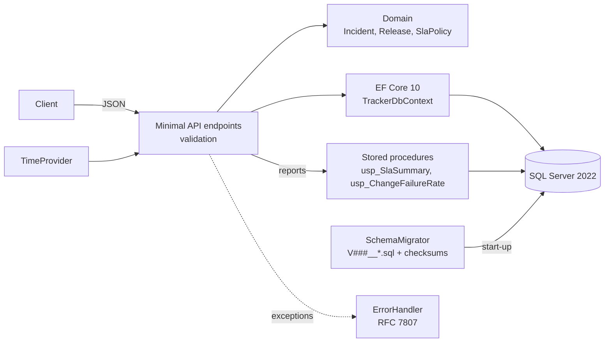
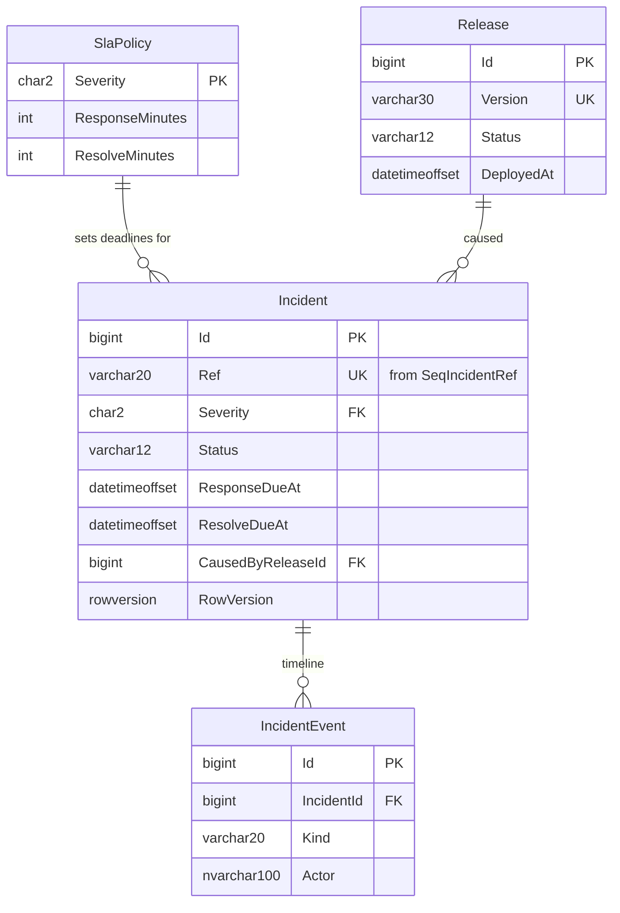
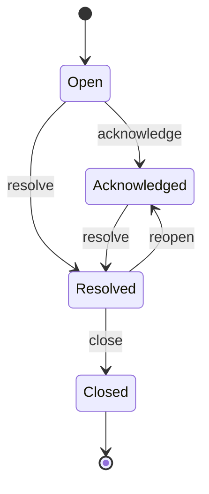

# incident-sla-tracker: Design document

| | |
|---|---|
| Author | Sallehuddin Mohd Zakinuddin |
| Status | v1.0.0 written; first compile and test run in GitHub Actions |
| Last updated | November 2026 |

## 1. Context

Operations teams are measured on two things: how fast they respond to and fix incidents (SLA), and how often
releases break production (change failure rate). Both are often tracked in spreadsheets filled in after the fact.
This project records incidents and releases as they happen, enforces the incident workflow, and computes both
measures in SQL Server. It is also a deliberate move into the Microsoft stack: C#, ASP.NET Core, EF Core and
T-SQL. All data is fictional.

## 2. Goals and non-goals

**Goals**

1. Incidents carry deadlines derived from severity; breaches are computed, never typed in.
2. The workflow cannot be bypassed by any caller, and every step is recorded.
3. The schema is versioned T-SQL, applied automatically and protected against edits.
4. Reports run as stored procedures with indexes that suit them.
5. Concurrent edits are detected, not lost.
6. Integration tests run against real SQL Server, not an in-memory fake.

**Non-goals (this version)**

- Authentication, business-hours SLA calendars, notifications.
- A user interface (OpenAPI document and `requests.http` are enough to exercise it).

## 3. Architecture

| Part | Responsibility | Rule |
|---|---|---|
| Endpoints | Bind and validate requests, call the domain, map to DTOs | No business rules |
| Domain | Workflow, deadlines, breach checks, audit events | State changes only through methods |
| EF Core | Load and save aggregates; `rowversion` concurrency | Does not create or alter tables |
| T-SQL scripts | Tables, constraints, indexes, sequence, procedures | Applied once; never edited after |
| `TimeProvider` | The current time | Injected so tests can move the clock |

## 4. Data model

### Incident workflow

## 5. Key decisions

| # | Decision | Alternatives | Reason |
|---|---|---|---|
| 1 | T-SQL scripts own the schema; EF only maps | EF Core migrations | Scripts are what a DBA reviews and what production runs; procedures, filtered indexes and sequences are first-class |
| 2 | Own migrator with SHA-256 checksums | DbUp, manual runs | Small and transparent; an edited script stops start-up (same rule as Flyway) |
| 3 | References from `SEQUENCE dbo.SeqIncidentRef` | IDENTITY, GUID | Known before insert and readable; fetched without composing, because SQL Server forbids `NEXT VALUE FOR` inside a derived table |
| 4 | Deadlines stored on the incident at open time | Computed on read from the policy | A later policy change does not rewrite history; reports compare stored deadlines with stored timestamps |
| 5 | Reopen keeps the original deadlines | Reset the clock | A reopened incident was not actually fixed; resetting would hide breaches |
| 6 | Reports as stored procedures | LINQ | `PERCENTILE_CONT` and window functions are natural in T-SQL; plans can be tuned in place |
| 7 | Filtered index on unresolved incidents | Full index on `ResolveDueAt` | Only open rows are searched for breaches; the index stays small as history grows |
| 8 | `rowversion` optimistic concurrency | Locks; last write wins | Two engineers updating one incident get a 409 instead of silently losing a change |
| 9 | `TimeProvider` injected | `DateTime.UtcNow` | SLA tests move the clock hours ahead without waiting |
| 10 | Testcontainers SQL Server for integration tests | EF in-memory provider, SQLite | Procedures, sequences, filtered indexes and rowversion only behave correctly on SQL Server |
| 11 | Enums stored as `varchar` with CHECK constraints | Integers | Readable in SQL and reports; safe to reorder in C# |

## 6. Reports

**SLA summary** (`dbo.usp_SlaSummary @From, @To, @Now`) for incidents opened in the window, per severity:

| Column | Definition |
|---|---|
| Total, StillOpen | Count of incidents; those not yet resolved |
| ResponseMet | Acknowledged (or, if not yet, `@Now`) on or before `ResponseDueAt` |
| ResolveMet | Resolved (or `@Now`) on or before `ResolveDueAt`; open incidents past their deadline count as missed |
| AvgResolveMinutes, P90ResolveMinutes | Over resolved incidents; P90 with `PERCENTILE_CONT(0.9)` |

**Change failure rate** (`dbo.usp_ChangeFailureRate @From, @To`) per month: deployments that were rolled back or
are named as the cause of at least one incident, divided by all deployments. SQL Server does not allow a
subquery inside `SUM`, so failed releases are collected in a CTE and joined.

**Index support**

| Query | Index |
|---|---|
| List by status and severity, newest first | `IX_Incident_Status_Severity (Status, Severity, OpenedAt DESC) INCLUDE (...)` |
| Open incidents ordered by deadline | `IX_Incident_Open_ResolveDue (ResolveDueAt) WHERE Status IN ('Open','Acknowledged')` |
| Reports by open date | `IX_Incident_OpenedAt (OpenedAt) INCLUDE (Severity, timestamps, deadlines)` covers `usp_SlaSummary` |
| Failed releases | `IX_Incident_CausedByRelease WHERE CausedByReleaseId IS NOT NULL` |

To check a plan: run `SET STATISTICS IO ON; EXEC dbo.usp_SlaSummary ...` in SSMS or Azure Data Studio with
"Include Actual Execution Plan" and confirm an index seek on `IX_Incident_OpenedAt` with no key lookups.

## 7. Testing

| Level | Tests | What they prove |
|---|---|---|
| Unit | `IncidentTests`, `ReleaseTests`, `SchemaMigratorTests` | Deadlines, workflow, breach rules, reopen, batch splitting, checksums |
| Integration (SQL Server 2022 container) | `ApiTests` (10) | Migrations once and tamper detection; sequence references; workflow 409s; validation 400s; breaching filter with a moved clock; SLA report numbers including P90; change failure rate; rowversion conflict; filtered index exists |
| CI smoke | Docker Compose | The published image starts against SQL Server and serves requests |

The SLA test opens two P2 incidents, meets both targets with one and misses both with the other, then checks
50 % compliance, an average of 360 minutes and a P90 of 552 minutes (120 + 0.9 × 480).

## 8. Security

- EF Core and `SqlCommand` parameters only; the one piece of dynamic SQL (`CREATE DATABASE`) uses `QUOTENAME`.
- Input length limits match column sizes; enums validated.
- Container runs as the non-root `app` user.
- Not done yet: authentication and authorisation. Do not expose this build publicly.

## 9. Future work

1. Business-hours SLA calendars and public holidays per region.
2. Authentication with roles (service desk opens, engineers resolve, leads close).
3. A small React dashboard over the two reports.
4. Notifications when an incident is within 15 minutes of a deadline (background service using the filtered index).
